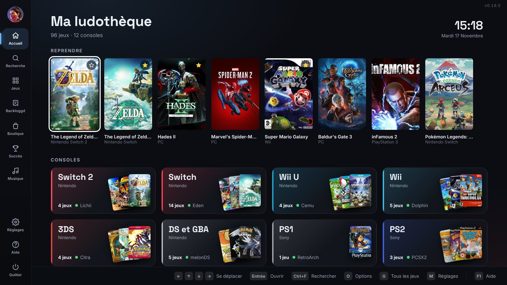
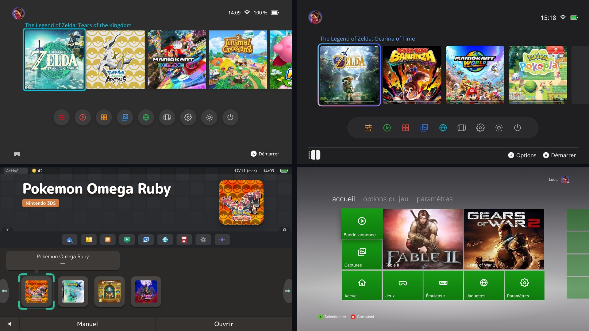
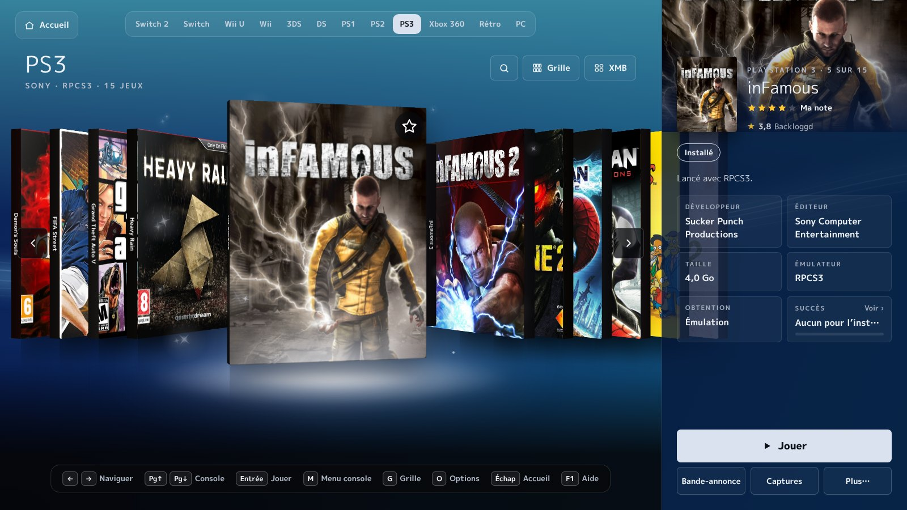
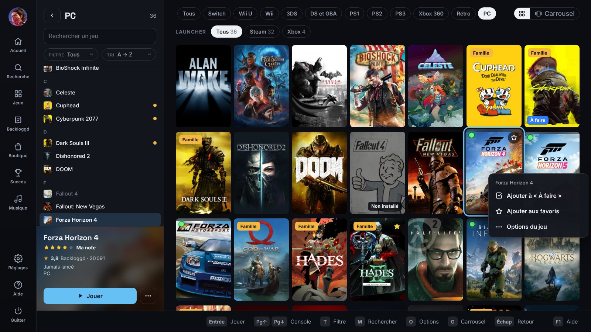
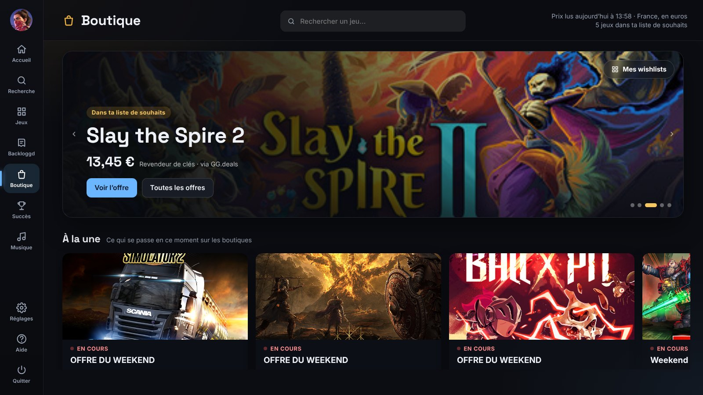
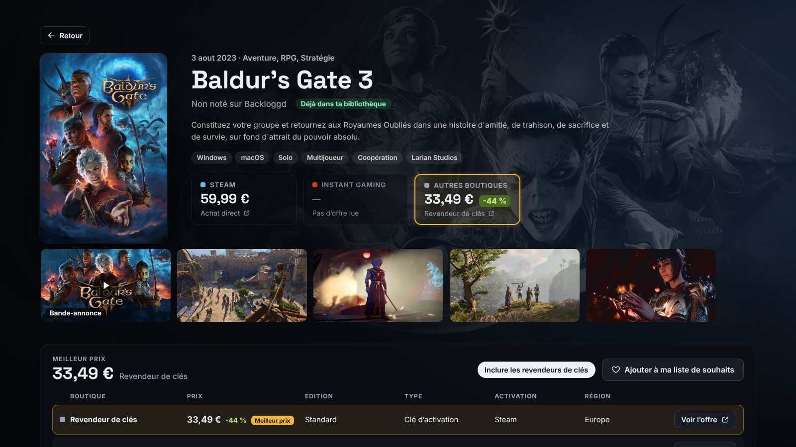
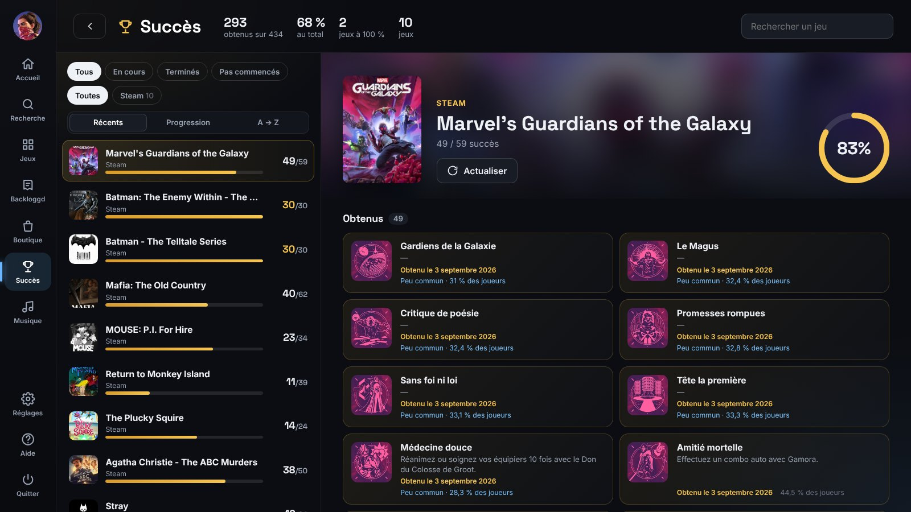
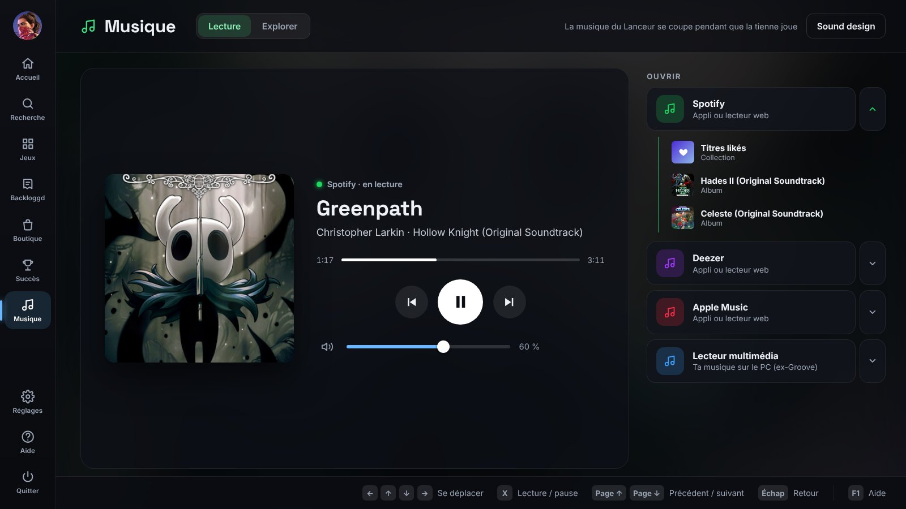

<h1 align="center">Lanceur</h1>

  <b>Tes jeux d'émulation et tous tes jeux PC réunis dans un seul lanceur, avec l'ambiance de chaque console.</b> 
  Pour Windows 10 et 11 · à la manette ou au clavier · <b>version bêta</b>

  

> [!NOTE]
> **Le Lanceur est en bêta.** Ce n'est pas encore la version définitive : pour l'instant, il s'agit surtout de corriger et d'améliorer ce qui existe déjà, plus que d'ajouter des nouveautés. Des correctifs, des mises à jour et de nouvelles fonctions arriveront au fil des versions, et elles s'installeront automatiquement depuis l'application.

  

Au premier lancement, le Lanceur parcourt ton PC : il trouve tes émulateurs et tes jeux, puis va chercher leurs jaquettes. L'accueil montre ensuite les jeux auxquels tu as joué récemment et une carte par console, avec son nombre de jeux et l'émulateur utilisé.

## Ce que fait le Lanceur

- **Toute ta ludothèque au même endroit**
    - Tes jeux d'émulation : Switch 2, Switch, Wii U, Wii, 3DS, DS, PS1, PS2, PS3, Xbox 360 et rétro
    - Tous tes jeux PC : Steam, Epic, GOG, Ubisoft Connect, EA, Battle.net, Xbox et Rockstar
- **Chaque console a son univers** : son carrousel, ses couleurs, ses sons, et un menu inspiré de la console quand la vraie en avait un
- **Une boutique qui compare les prix** : le prix le plus bas de chaque jeu, entre plusieurs boutiques officielles et revendeurs de clés
- **Tes succès et ta musique** : tes succès réunis au même endroit, et ta musique pilotée sans quitter le Lanceur

## Chaque console a son univers

Certaines consoles ont droit à un menu inspiré de l'original, uniquement celles qui en avaient un : l'écran d'accueil de la Switch et de la Switch 2, le menu de la 3DS, le tableau de bord de la Xbox 360… Ce ne sont pas les vrais menus, mais des clins d'œil fidèles, où tu retrouves tes jeux, ta photo de profil et ton pseudo.

  

Tu peux aussi parcourir tes jeux en carrousel de boîtiers ou en grille, sans limite de nombre de jeux. Sur le côté, la fiche du jeu sélectionné donne :

- Ta note et celle de Backloggd
- Le développeur et l'éditeur
- La taille du jeu et l'émulateur utilisé
- Tes succès
- La bande-annonce et des captures d'écran

  

## Toute ta bibliothèque

Tous tes jeux sur une seule page. Tu peux les filtrer par console, par launcher (Steam, Xbox…) ou par état : installés, non installés, À faire, Favoris, Famille. Tu peux aussi les trier par nom, par jeux récents ou par temps de jeu.

  

Les jaquettes te donnent l'essentiel d'un coup d'œil :

| Sur la jaquette | Ce que ça veut dire |
|---|---|
| **Famille** | Un jeu de la bibliothèque familiale Steam, prêté par un proche |
| **À faire** | Un jeu que tu as mis de côté pour plus tard |
| ⭐ | Un favori |
| Voyant vert | Un jeu du Game Pass : le voyant est vert quand ton abonnement est actif, gris s'il ne l'est pas |
| **Non installé**, en grisé | Le jeu t'appartient, mais il n'est pas sur ce PC |

Fais un clic droit sur un jeu, ou maintiens Start à la manette, pour l'ajouter à « À faire », à tes favoris ou à ta liste de souhaits, ou pour ouvrir ses options : changer sa jaquette, choisir son émulateur…

## La Boutique

Les nouveautés, les promos, les meilleures ventes, les événements Steam du moment et ta liste de souhaits. Ta liste réunit celle de **Steam** et celle de **Backloggd** (jeux PC uniquement). Les jeux que tu as déjà sont signalés.

  
  

Sur la page d'un jeu, le Lanceur compare les prix de :

- **Boutiques officielles** : Steam, Epic Games Store, GOG
- **Revendeurs de clés** : Instant Gaming
- **Comparateurs de prix** : AllKeyShop, GG.deals

Le moins cher est mis en avant, avec son pourcentage de réduction. Chaque prix est un bouton qui ouvre directement l'offre. Les clés en rupture de stock sont grisées. Quand il y a plusieurs éditions, le Lanceur les compare aussi.

Dans les réglages, tu choisis la boutique dont le prix s'affiche en priorité. Sur la page du jeu, tu peux aussi masquer les revendeurs de clés.

## Succès et musique

  
  

**Succès** : tes succès sont réunis au même endroit, qu'ils viennent de **Steam**, **Xbox** (jeux PC), **GOG**, des trophées **PS3** (RPCS3) ou de **RetroAchievements**. Pour chaque jeu, tu vois :

- Ta progression
- La date de chaque succès
- Sa rareté, c'est-à-dire la part de joueurs qui l'ont obtenu

Tu peux filtrer les jeux en cours, terminés ou pas commencés.

> [!IMPORTANT]
> Pour les jeux de consoles, ce sont les succès enregistrés par l'émulateur (RPCS3, RetroAchievements…), pas ceux de tes comptes PlayStation, Xbox ou Nintendo.

**Musique** : le Lanceur pilote **Spotify**, **Deezer**, **Apple Music** ou le lecteur de Windows : lecture, pause, morceau suivant et volume, sans changer de fenêtre. Pendant que ta musique joue, celle du Lanceur se coupe toute seule. L'onglet Explorer te propose :

- Les bandes originales de tes jeux
- Des ambiances, du lo-fi aux musiques de combat
- Des suggestions selon tes goûts

## Prochainement

- Télécharger et mettre à jour tes jeux directement depuis le Lanceur (jeux PC uniquement : le téléchargement des jeux d'émulation n'est pas encore pris en charge)
- Un logo et une icône
- Un vrai nom à la place de « Lanceur »

## Installer

1. Télécharge **Lanceur-Setup-x.y.z.exe** dans la [dernière version](https://github.com/CobyTV/Lanceur/releases/latest).
2. Lance-le. Si Windows affiche « Windows a protégé votre ordinateur », clique sur
   « Informations complémentaires » puis « Exécuter quand même ».
3. Choisis si tu veux un raccourci sur le Bureau et le lancement au démarrage de Windows.

Les mises à jour arrivent ensuite toutes seules : au démarrage, une fenêtre propose la nouvelle version.

  

